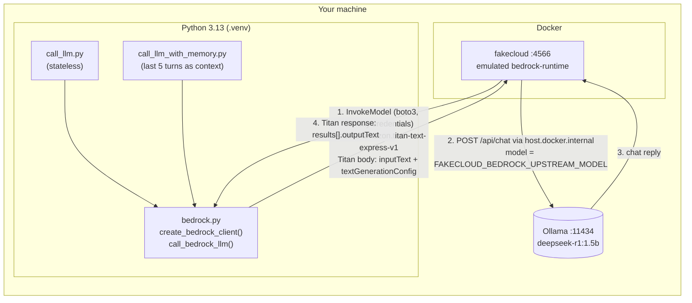

# local-bedrock

Call AWS Bedrock's API locally, without an AWS account. [fakecloud](https://github.com/faiscadev/fakecloud) emulates AWS at `localhost:4566` and forwards Bedrock `InvokeModel` requests to a local [Ollama](https://ollama.com) instance.

## Architecture



1. A script wraps your question in its `DEFAULT_PROMPT` and calls `call_bedrock_llm()`, which sends a Bedrock `InvokeModel` request with boto3 to `localhost:4566` instead of AWS.
2. fakecloud translates it into an Ollama `/api/chat` request. It ignores the model in `modelId` and uses `FAKECLOUD_BEDROCK_UPSTREAM_MODEL` from `docker-compose.yml`; the container reaches the host's Ollama through `host.docker.internal`.
3. Ollama generates the reply with the local model.
4. fakecloud wraps the reply in the response format of the requested `modelId` (Titan here), and `call_bedrock_llm()` extracts the text. Real AWS is never contacted.

## Requirements

- Docker with Compose
- Python 3.13
- Ollama running on your host with the desired model pulled

## Setup

```bash
# 1. Start the AWS emulator
docker compose up -d

# 2. Create the virtual environment and install dependencies
python3 -m venv .venv
source .venv/bin/activate
pip install -r requirements.txt

# 3. Make sure your model exists in Ollama
ollama pull deepseek-r1:1.5b
```

## Usage

Both scripts open an interactive loop: type a question at the `>>>` prompt, read the reply, repeat. Type `exit` to quit.

```bash
python call_llm.py               # stateless: each question is sent on its own
python call_llm_with_memory.py   # chat: recent turns are sent as context
```

| Script | Behaviour |
|---|---|
| `call_llm.py` | Wraps each question in `DEFAULT_PROMPT` (asks for one short sentence, max 20 words) and prints the reply. No memory between questions. |
| `call_llm_with_memory.py` | Keeps an in-memory `session_history` and injects it into `DEFAULT_PROMPT` as `User:` / `Assistant:` lines, so the model can refer to earlier turns. Only the last 5 turns are kept; history is lost on exit. |

Each script defines its own `DEFAULT_PROMPT`; edit it there to change the prompt. Everything else is shared in `bedrock.py`: the boto3 client (`create_bedrock_client`), the request/response handling (`call_bedrock_llm`), generation settings in `textGenerationConfig` (`temperature` 0.2, `maxTokenCount` 1000), and the real Bedrock model ID `amazon.titan-text-express-v1` (`DEFAULT_MODEL_ID`). Which Ollama model responds is configured in `docker-compose.yml` (see Configuration).

The boto3 client uses `endpoint_url="http://localhost:4566"` and dummy credentials, so the real AWS cloud is never contacted. The request body follows the Amazon Titan text format (`inputText` + `textGenerationConfig`).

## Configuration

fakecloud forwards Bedrock calls using these variables from `docker-compose.yml`:

| Variable | Value | Purpose |
|---|---|---|
| `FAKECLOUD_BEDROCK_UPSTREAM_URL` | `http://host.docker.internal:11434` | Ollama base URL, as seen from the container |
| `FAKECLOUD_BEDROCK_UPSTREAM_PROTOCOL` | `ollama` | Upstream API (`/api/chat`) |
| `FAKECLOUD_BEDROCK_UPSTREAM_MODEL` | `deepseek-r1:1.5b` | Ollama model actually serving requests |

If `FAKECLOUD_BEDROCK_UPSTREAM_URL` is not set, fakecloud returns a canned `"This is a test response from the emulated model."`.

fakecloud strips everything up to the last `.` in `modelId` (treating it as a Bedrock provider prefix), so `deepseek-r1:1.5b` would reach Ollama as `5b`. This is why the Ollama model is set using `FAKECLOUD_BEDROCK_UPSTREAM_MODEL`. To switch models, change that variable and rerun `docker compose up -d`.

The response format depends on `modelId`: a Titan ID such as `amazon.titan-text-express-v1` returns `results[].outputText`; other IDs return `{"output": "..."}`. `call_bedrock_llm` handles either shape, plus `outputs[].text`.

DeepSeek-R1 reasons before answering, so keep `maxTokenCount` high (1000 in the script). With only 100 tokens, it exhausts before finishing and returns an empty output.

## SBOM

`sbom.cdx.json` is a [CycloneDX](https://cyclonedx.org) 1.6 software bill of materials for the Python dependencies in `requirements.txt`, with versions, licences, package URLs and the dependency graph. It does not cover the `fakecloud` container image or Ollama.

To regenerate it after changing dependencies (requires [uv](https://docs.astral.sh/uv/)):

```bash
uvx --from cyclonedx-bom cyclonedx-py environment .venv/bin/python \
  --mc-type application --output-reproducible --of JSON -o sbom.cdx.json
```

The venv's own `pip` ends up in the output; remove its entry from `components` and `dependencies` so the SBOM matches `requirements.txt`.

## Troubleshooting

- **Check emulator logs:** `docker logs -f fakecloud`
- **Canned test response instead of real model output:** `FAKECLOUD_BEDROCK_UPSTREAM_URL` is not set. Recreate the container with `docker compose up -d`.
- **`model '5b' not found`:** `FAKECLOUD_BEDROCK_UPSTREAM_MODEL` is missing (see Configuration).
- **Ollama only listening on localhost:** start it with `OLLAMA_HOST=0.0.0.0 ollama serve` so the container can connect.
